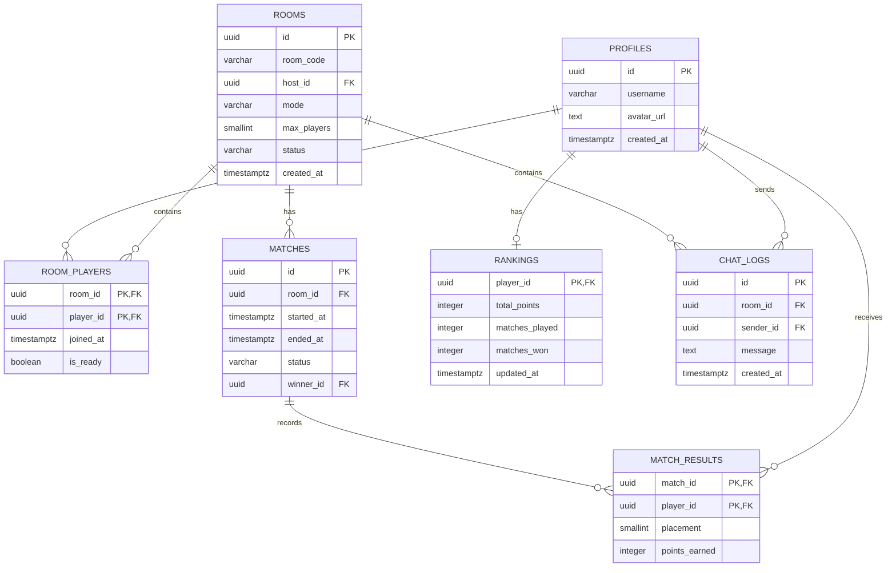

# Thiết kế cơ sở dữ liệu — Game Tiến Lên Miền Nam

**Môn học:** NT106
**Nhóm:** 9

## 1. Công nghệ sử dụng

- **Hệ quản trị cơ sở dữ liệu:** PostgreSQL.
- **Xác thực người dùng:** Supabase Authentication.
- **Lưu trữ dữ liệu:** PostgreSQL thông qua Supabase.

Supabase Authentication quản lý tài khoản và xác thực người dùng. Các dữ liệu như hồ sơ người chơi, phòng chơi, lịch sử ván, bảng xếp hạng và tin nhắn được lưu trong PostgreSQL.

## 2. Danh sách bảng dữ liệu

Dự kiến hệ thống sử dụng các bảng sau:

| Bảng            | Chức năng                                          |
| --------------- | -------------------------------------------------- |
| `profiles`      | Lưu thông tin hồ sơ người chơi.                    |
| `rooms`         | Lưu thông tin phòng chơi.                          |
| `room_players`  | Lưu danh sách người chơi trong từng phòng.         |
| `matches`       | Lưu thông tin các ván đấu.                         |
| `match_results` | Lưu kết quả và thứ hạng người chơi trong từng ván. |
| `rankings`      | Lưu hoặc tổng hợp điểm xếp hạng người chơi.        |
| `chat_logs`     | Lưu lịch sử tin nhắn trong phòng.                  |

## 3. Chi tiết các bảng

### 3.1. Bảng `profiles`

Lưu thông tin hồ sơ của người chơi đã được xác thực.

| Trường       | Kiểu dữ liệu dự kiến | Mô tả                                                     |
| ------------ | -------------------- | --------------------------------------------------------- |
| `id`         | UUID                 | Khóa chính, tham chiếu ID người dùng trong Supabase Auth. |
| `username`   | VARCHAR(50)          | Tên hiển thị của người chơi.                              |
| `avatar_url` | TEXT                 | Đường dẫn ảnh đại diện, có thể để trống.                  |
| `created_at` | TIMESTAMPTZ          | Thời điểm tạo hồ sơ.                                      |

### 3.2. Bảng `rooms`

Lưu thông tin các phòng chơi.

| Trường        | Kiểu dữ liệu dự kiến | Mô tả                                           |
| ------------- | -------------------- | ----------------------------------------------- |
| `id`          | UUID                 | Khóa chính của phòng.                           |
| `room_code`   | VARCHAR(10)          | Mã phòng để người chơi tham gia.                |
| `host_id`     | UUID                 | ID người tạo phòng, tham chiếu `profiles.id`.   |
| `mode`        | VARCHAR(20)          | Chế độ chơi đã chọn.                            |
| `max_players` | SMALLINT             | Số người chơi tối đa: 2 hoặc 4.                 |
| `status`      | VARCHAR(20)          | Trạng thái phòng: chờ, đang chơi hoặc kết thúc. |
| `created_at`  | TIMESTAMPTZ          | Thời điểm tạo phòng.                            |

### 3.3. Bảng `room_players`

Lưu thông tin người chơi tham gia từng phòng.

| Trường      | Kiểu dữ liệu dự kiến | Mô tả                                |
| ----------- | -------------------- | ------------------------------------ |
| `room_id`   | UUID                 | Khóa ngoại tham chiếu `rooms.id`.    |
| `player_id` | UUID                 | Khóa ngoại tham chiếu `profiles.id`. |
| `joined_at` | TIMESTAMPTZ          | Thời điểm tham gia phòng.            |
| `is_ready`  | BOOLEAN              | Trạng thái sẵn sàng của người chơi.  |

Khóa chính dự kiến là cặp (`room_id`, `player_id`) để tránh một người chơi có nhiều bản ghi trong cùng phòng.

### 3.4. Bảng `matches`

Lưu thông tin từng ván đấu.

| Trường       | Kiểu dữ liệu dự kiến | Mô tả                                                         |
| ------------ | -------------------- | ------------------------------------------------------------- |
| `id`         | UUID                 | Khóa chính của ván đấu.                                       |
| `room_id`    | UUID                 | Khóa ngoại tham chiếu `rooms.id`.                             |
| `started_at` | TIMESTAMPTZ          | Thời điểm bắt đầu ván.                                        |
| `ended_at`   | TIMESTAMPTZ          | Thời điểm kết thúc ván, có thể để trống.                      |
| `status`     | VARCHAR(20)          | Trạng thái ván đấu.                                           |
| `winner_id`  | UUID                 | ID người thắng, có thể để trống nếu hòa hoặc chưa có kết quả. |

### 3.5. Bảng `match_results`

Lưu thứ hạng và điểm của từng người chơi trong mỗi ván.

| Trường          | Kiểu dữ liệu dự kiến | Mô tả                                |
| --------------- | -------------------- | ------------------------------------ |
| `match_id`      | UUID                 | Khóa ngoại tham chiếu `matches.id`.  |
| `player_id`     | UUID                 | Khóa ngoại tham chiếu `profiles.id`. |
| `placement`     | SMALLINT             | Thứ hạng của người chơi trong ván.   |
| `points_earned` | INTEGER              | Điểm nhận được trong ván.            |

Khóa chính dự kiến là cặp (`match_id`, `player_id`).

### 3.6. Bảng `rankings`

Lưu điểm xếp hạng tổng hợp của người chơi.

| Trường           | Kiểu dữ liệu dự kiến | Mô tả                                 |
| ---------------- | -------------------- | ------------------------------------- |
| `player_id`      | UUID                 | Khóa chính, tham chiếu `profiles.id`. |
| `total_points`   | INTEGER              | Tổng điểm xếp hạng.                   |
| `matches_played` | INTEGER              | Tổng số ván đã tham gia.              |
| `matches_won`    | INTEGER              | Tổng số ván thắng.                    |
| `updated_at`     | TIMESTAMPTZ          | Thời điểm cập nhật gần nhất.          |

Điểm xếp hạng phải được cập nhật nhất quán với kết quả trong `match_results`.

### 3.7. Bảng `chat_logs`

Lưu lịch sử tin nhắn trong phòng.

| Trường       | Kiểu dữ liệu dự kiến | Mô tả                                   |
| ------------ | -------------------- | --------------------------------------- |
| `id`         | UUID                 | Khóa chính của tin nhắn.                |
| `room_id`    | UUID                 | Khóa ngoại tham chiếu `rooms.id`.       |
| `sender_id`  | UUID                 | ID người gửi, tham chiếu `profiles.id`. |
| `message`    | TEXT                 | Nội dung tin nhắn.                      |
| `created_at` | TIMESTAMPTZ          | Thời điểm gửi tin nhắn.                 |

## 4. Quan hệ giữa các bảng

- Một hồ sơ người chơi có thể tham gia nhiều phòng thông qua `room_players`.
- Một phòng có thể có nhiều người chơi và có nhiều ván đấu theo thời gian.
- Mỗi ván đấu có thể có kết quả của nhiều người chơi trong `match_results`.
- Mỗi người chơi có thể có nhiều kết quả ván đấu.
- Mỗi người chơi có một bản ghi tổng hợp trong `rankings`.
- Một phòng có thể có nhiều tin nhắn trong `chat_logs`.

## 5. Sơ đồ quan hệ dữ liệu

## 6. Nguyên tắc thiết kế

- Dùng UUID để định danh các bản ghi chính.
- Thiết lập khóa chính, khóa ngoại và ràng buộc dữ liệu phù hợp.
- Không lưu mật khẩu dạng văn bản thuần trong bảng `profiles`; việc xác thực do Supabase Authentication đảm nhiệm.
- Chỉ lưu dữ liệu cần thiết cho hồ sơ, phòng chơi, lịch sử ván, kết quả, xếp hạng và trò chuyện.
- Phân quyền truy cập bằng Row Level Security (RLS) của Supabase.
- Trạng thái ván đấu và nước đánh hợp lệ phải được xử lý, xác thực bởi server game; không tin dữ liệu do client tự gửi lên.
- Không lưu bài trên tay của người chơi vào dữ liệu công khai hoặc gửi bài riêng của người chơi khác cho client.
