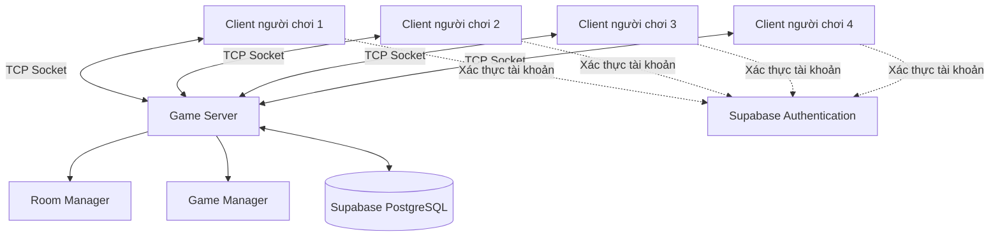
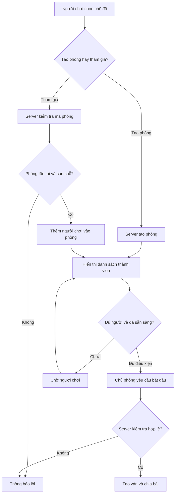

# Thiết kế xử lý mạng và phòng chơi

**Môn học:** NT106  
**Nhóm:** 9  
**Dự án:** Game Tiến Lên Miền Nam

## 1. Mục tiêu

Thiết kế cơ chế giao tiếp giữa client và server, quản lý kết nối người chơi và tổ chức phòng chơi. Hệ thống cần bảo đảm các client nhận được trạng thái phòng và ván đấu nhất quán, đồng thời server chịu trách nhiệm kiểm tra các hành động của người chơi.

## 2. Công nghệ và mô hình mạng

### 2.1. Công nghệ dự kiến

- **Mô hình:** Client–Server.
- **Giao thức truyền dữ liệu:** TCP Socket.
- **Định dạng thông điệp:** JSON.
- **Xác thực tài khoản:** Supabase Authentication.
- **Cơ sở dữ liệu:** PostgreSQL thông qua Supabase.

TCP Socket được dùng để trao đổi dữ liệu giữa client và game server. Supabase Authentication phục vụ xác thực tài khoản; PostgreSQL lưu thông tin người chơi, phòng chơi, lịch sử ván đấu và bảng xếp hạng.

### 2.2. Mô hình hoạt động



Game Server là nơi xử lý các yêu cầu mạng và điều phối trạng thái phòng, ván đấu. Room Manager quản lý phòng; Game Manager quản lý luật chơi, lượt đánh và kết quả. Hai thành phần quản lý này có thể được triển khai thành các module trong cùng một server.

## 3. Thiết kế xử lý kết nối mạng

### 3.1. Thiết lập kết nối

1. Client thiết lập kết nối TCP đến Game Server.
2. Server chấp nhận kết nối và tạo phiên kết nối cho client.
3. Client thực hiện xác thực tài khoản theo thiết kế đăng nhập.
4. Server kiểm tra quyền truy cập trước khi cho phép client thực hiện các thao tác yêu cầu xác thực.
5. Khi kết nối bị đóng hoặc gặp lỗi, server cập nhật trạng thái kết nối và xử lý theo quy tắc của phòng hoặc ván đấu.

### 3.2. Gửi và nhận thông điệp

Mỗi thông điệp có trường `type` để xác định loại yêu cầu và trường `payload` để chứa dữ liệu.

Ví dụ yêu cầu tham gia phòng:

```json
{
  "type": "JOIN_ROOM",
  "requestId": "req_002",
  "payload": {
    "roomCode": "AB123"
  }
}
```

Ví dụ thông báo lỗi:

```json
{
  "type": "ERROR",
  "requestId": "req_002",
  "payload": {
    "code": "ROOM_NOT_FOUND",
    "message": "Không tìm thấy phòng chơi."
  }
}
```

Các tên trường và mã lỗi trên là đề xuất, cần thống nhất với tài liệu `docs/tcp-protocol.md`.

Vì TCP truyền dữ liệu dưới dạng luồng byte, server phải có quy tắc phân tách thông điệp hoàn chỉnh, chẳng hạn sử dụng JSON kết thúc bằng ký tự xuống dòng. Không được giả định một lần nhận dữ liệu tương ứng với một thông điệp đầy đủ.

### 3.3. Nguyên tắc xử lý mạng

- Kiểm tra cấu trúc và nội dung của từng thông điệp trước khi xử lý.
- Xác thực quyền của người gửi đối với phòng và hành động yêu cầu.
- Server là nguồn trạng thái chính thức của ván đấu.
- Không tin tưởng dữ liệu bài hoặc kết quả do client tự khai báo.
- Gửi thông báo cập nhật đến đúng những client có quyền nhận dữ liệu.
- Không gửi bài trên tay của người chơi khác cho client.
- Xử lý lỗi kết nối và dữ liệu không hợp lệ mà không làm dừng toàn bộ server.

## 4. Thiết kế quản lý phòng chơi

### 4.1. Chế độ chơi

Hệ thống dự kiến hỗ trợ:

| Chế độ | Số người | Mô tả |
|---|---:|---|
| Đấu 2 người | 2 người thật | Hai người chơi trực tiếp với nhau. |
| Đấu 4 người | 4 người thật | Bốn người chơi cùng tham gia một ván. |
| Đấu với Bot | 1 người thật và 1 Bot | Người chơi chọn chế độ đấu Bot, có thể chọn độ khó. |

Ở chế độ đấu với Bot, hệ thống không tự động thêm Bot vào phòng đấu người thật đang thiếu người.

### 4.2. Các chức năng phòng chơi

- **Tạo phòng:** Người chơi tạo phòng và trở thành chủ phòng.
- **Tham gia phòng:** Người chơi nhập mã phòng hợp lệ để tham gia.
- **Xem thành viên:** Hiển thị danh sách thành viên và trạng thái sẵn sàng.
- **Sẵn sàng:** Người chơi thông báo đã sẵn sàng.
- **Bắt đầu ván:** Chỉ chủ phòng được yêu cầu bắt đầu; server kiểm tra điều kiện trước khi xử lý.
- **Rời phòng:** Người chơi gửi yêu cầu rời phòng.
- **Cập nhật phòng:** Server gửi thông báo khi thành viên hoặc trạng thái phòng thay đổi.

### 4.3. Trạng thái phòng

Phòng có thể sử dụng các trạng thái sau:

| Trạng thái | Ý nghĩa |
|---|---|
| `WAITING` | Phòng đang chờ người chơi hoặc chờ sẵn sàng. |
| `PLAYING` | Ván đấu đang diễn ra. |
| `FINISHED` | Ván đấu đã kết thúc. |

Server kiểm soát việc chuyển trạng thái để tránh bắt đầu nhiều ván cùng lúc trong một phòng.

### 4.4. Điều kiện bắt đầu ván

Server chỉ cho phép bắt đầu khi:

1. Phòng đang ở trạng thái `WAITING`.
2. Người gửi yêu cầu là chủ phòng.
3. Số lượng người chơi phù hợp với chế độ đã chọn.
4. Các người chơi cần thiết đã sẵn sàng.
5. Phòng chưa có ván đấu đang diễn ra.

Khi các điều kiện được đáp ứng, server chuyển phòng sang trạng thái `PLAYING`, tạo ván mới, chia bài và thông báo cho các client.

### 4.5. Quy trình tạo và tham gia phòng



## 5. Xử lý lượt chơi và đồng bộ trạng thái

Khi một client gửi yêu cầu `PLAY` hoặc `PASS`:

1. Server xác định phòng và ván đấu tương ứng.
2. Server kiểm tra người chơi có thuộc ván và đang đến lượt hay không.
3. Server xác thực hành động theo luật Tiến Lên Miền Nam.
4. Nếu hợp lệ, server cập nhật trạng thái ván đấu.
5. Server gửi sự kiện cập nhật đến các client liên quan.
6. Nếu ván kết thúc, server ghi nhận kết quả và thực hiện quy trình cập nhật điểm.

Nếu yêu cầu không hợp lệ, server trả về thông báo lỗi và giữ nguyên trạng thái ván đấu.

## 6. Xử lý mất kết nối

Theo quy tắc dự kiến của dự án:

- **Chế độ 2 người hoặc đấu với Bot:** Nếu người chơi rời hoặc mất kết nối giữa ván, ván đấu kết thúc với kết quả hòa.
- **Chế độ 4 người:** Người chơi rời hoặc mất kết nối được xếp cuối và ván đấu tiếp tục với những người còn lại.
- Server thông báo trạng thái mới cho các thành viên còn kết nối.
- Cơ chế kết nối lại và thời gian chờ kết nối lại cần được nhóm thống nhất trước khi triển khai.

## 7. Bảo mật và tính nhất quán

- Chỉ người đã xác thực mới được thực hiện các thao tác yêu cầu đăng nhập.
- Server kiểm tra quyền chủ phòng trước khi cho phép bắt đầu ván.
- Người chơi không được gửi yêu cầu thay mặt cho người chơi khác.
- Server xác thực lượt đánh, quyền sở hữu lá bài và tính hợp lệ của tổ hợp bài.
- Các thao tác làm thay đổi trạng thái phòng hoặc ván đấu cần được đồng bộ để tránh xử lý xung đột.
- Quyền đọc và ghi dữ liệu PostgreSQL phải được giới hạn phù hợp; không để client tự sửa kết quả hoặc điểm xếp hạng.

## 8. Các trường hợp kiểm thử dự kiến

| Mã | Trường hợp | Kết quả mong đợi |
|---|---|---|
| NET01 | Client kết nối thành công | Server chấp nhận kết nối. |
| NET02 | Client gửi thông điệp sai định dạng | Server xử lý lỗi an toàn và phản hồi phù hợp nếu có thể. |
| ROOM01 | Tạo phòng hợp lệ | Phòng được tạo và trả mã phòng. |
| ROOM02 | Tham gia mã phòng không tồn tại | Server từ chối yêu cầu. |
| ROOM03 | Tham gia phòng đã đầy | Server từ chối yêu cầu. |
| ROOM04 | Người không phải chủ phòng yêu cầu bắt đầu | Server từ chối yêu cầu. |
| ROOM05 | Bắt đầu khi chưa đủ người hoặc chưa sẵn sàng | Server không bắt đầu ván. |
| GAME01 | Client đánh bài đúng lượt và hợp lệ | Server cập nhật ván và đồng bộ trạng thái. |
| GAME02 | Client đánh bài sai lượt | Server từ chối và giữ nguyên trạng thái. |
| NET03 | Client mất kết nối giữa ván | Server xử lý theo quy tắc của chế độ chơi. |
| NET04 | Nhiều thông điệp đến liên tiếp | Server phân tách và xử lý đúng từng thông điệp. |

## 9. Tài liệu liên quan

- `docs/requirements.md`: Phân tích yêu cầu hệ thống.
- `docs/tcp-protocol.md`: Đặc tả giao thức và cấu trúc thông điệp TCP.
- `docs/protocol-testing.md`: Đặc tả và kiểm thử giao thức.
- `docs/database-design.md`: Thiết kế cơ sở dữ liệu.
- `docs/uml/sequence-diagram.md`: Sơ đồ tuần tự của các luồng hoạt động.
