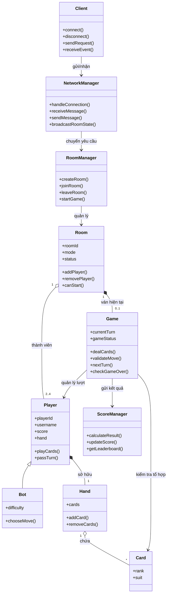

# CLASS DIAGRAM — GAME TIẾN LÊN MIỀN NAM

**Dự án:** NT106 — Nhóm 9

## 1. Sơ đồ lớp đề xuất

## 2. Trách nhiệm của từng lớp

| Lớp              | Trách nhiệm                                                        |
| ---------------- | ------------------------------------------------------------------ |
| `Client`         | Giao tiếp giữa giao diện người chơi và hệ thống mạng               |
| `NetworkManager` | Nhận yêu cầu, gửi thông điệp và đồng bộ dữ liệu                    |
| `RoomManager`    | Tạo phòng, tham gia phòng, rời phòng và kiểm tra điều kiện bắt đầu |
| `Room`           | Lưu mã phòng, chế độ, trạng thái và danh sách thành viên           |
| `Player`         | Lưu thông tin người chơi và thực hiện hành động trong lượt         |
| `Bot`            | Đưa ra nước đánh theo cấp độ khó                                   |
| `Game`           | Quản lý chia bài, lượt đánh, luật chơi và kết thúc ván             |
| `Card`           | Biểu diễn một lá bài bằng giá trị và chất                          |
| `Hand`           | Quản lý các lá bài trên tay một người chơi                         |
| `ScoreManager`   | Tính điểm, cập nhật kết quả và cung cấp bảng xếp hạng              |