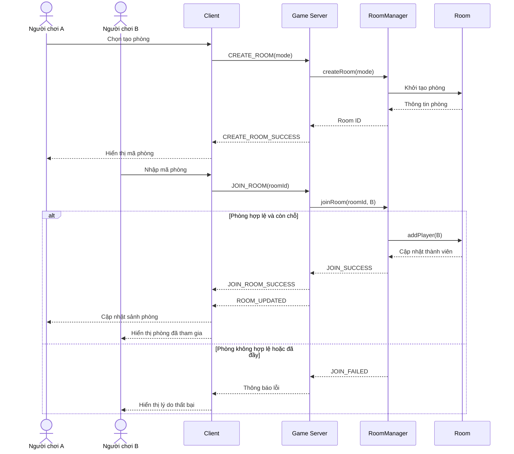
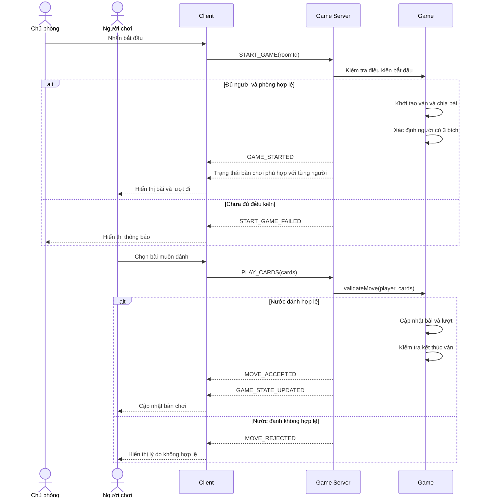
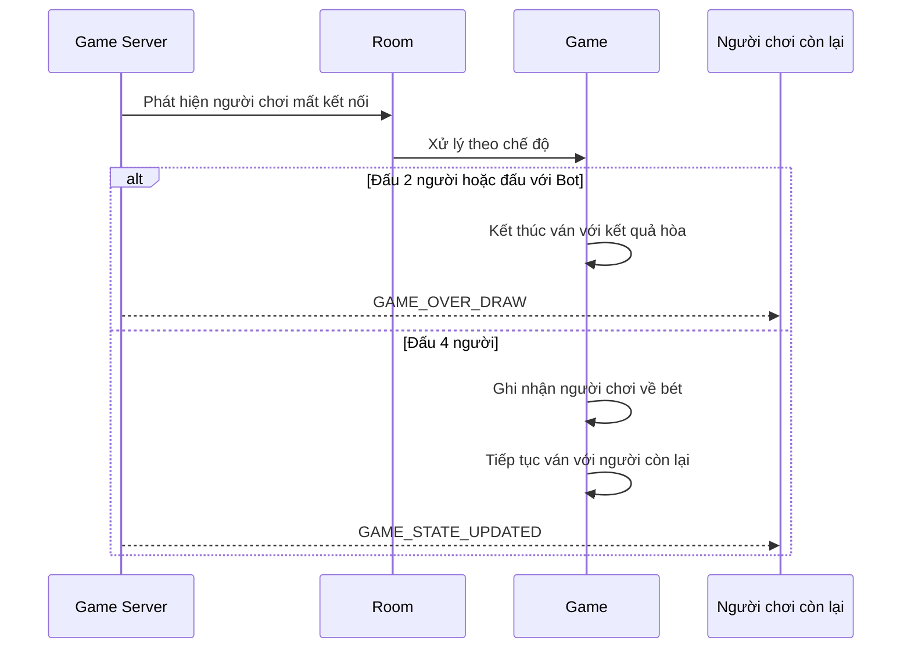

# SEQUENCE DIAGRAM — GAME TIẾN LÊN MIỀN NAM

**Dự án:** NT106 — Nhóm 9

## 1. Sequence Diagram: Tạo và tham gia phòng

## 2. Sequence Diagram: Bắt đầu ván và đánh bài

## 3. Sequence Diagram: Xử lý người chơi mất kết nối

## 4. Lưu ý triển khai

- Các tên thông điệp trong sơ đồ là tên đề xuất, nhóm có thể thay đổi theo giao thức thực tế.
- Server phải xác thực yêu cầu trước khi cập nhật trạng thái game.
- Dữ liệu bài trên tay phải được gửi riêng cho đúng người chơi; không phát tán bài riêng trong thông điệp đồng bộ chung.
- Luồng mất kết nối trong chế độ 4 người cần được thống nhất thêm về việc giữ kết quả người về bét và khả năng kết nối lại.
