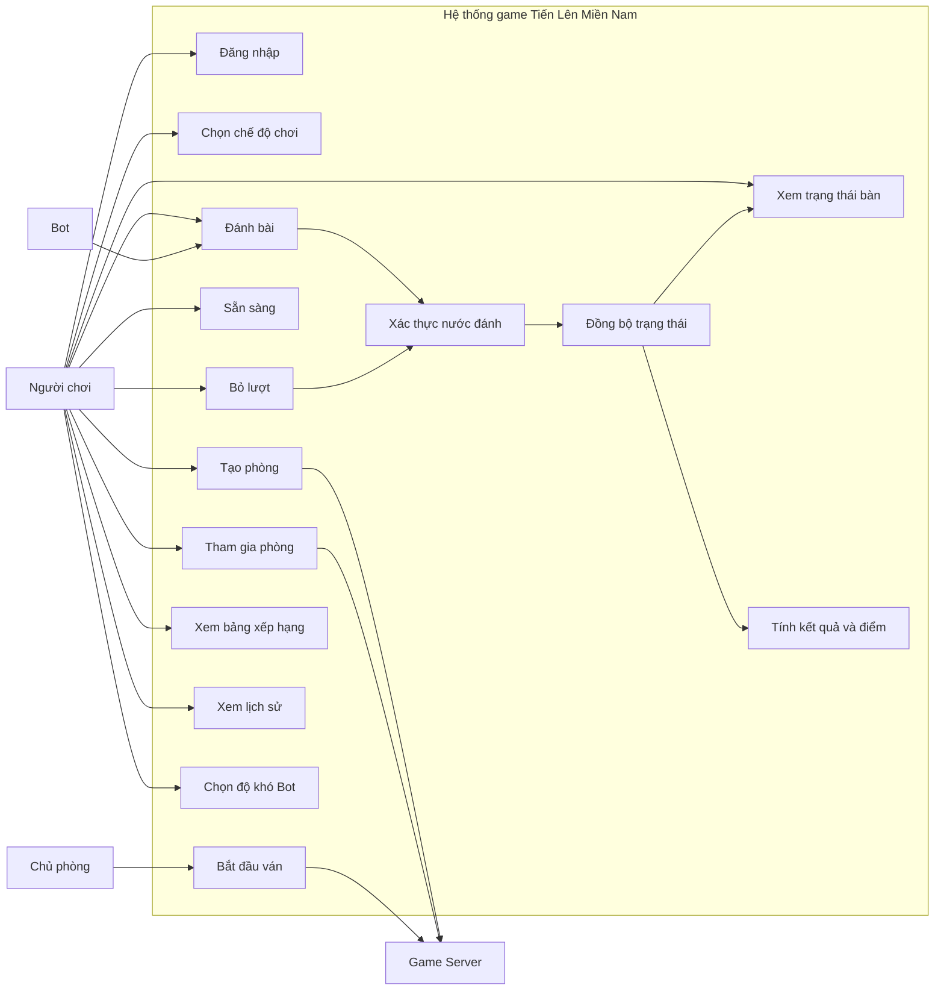

# USE CASE DIAGRAM — GAME TIẾN LÊN MIỀN NAM

**Dự án:** NT106 — Nhóm 9

## 1. Sơ đồ chức năng

## 2. Mô tả các Use Case

| Use Case          | Tác nhân chính | Kết quả                               |
| ----------------- | -------------- | ------------------------------------- |
| Đăng nhập         | Người chơi     | Truy cập hệ thống                     |
| Chọn chế độ       | Người chơi     | Xác định kiểu phòng                   |
| Tạo phòng         | Người chơi     | Phòng mới được tạo                    |
| Tham gia phòng    | Người chơi     | Thành viên được thêm vào phòng hợp lệ |
| Bắt đầu ván       | Chủ phòng      | Server bắt đầu ván nếu đủ điều kiện   |
| Đánh bài          | Người chơi/Bot | Nước đánh được server xác thực        |
| Bỏ lượt           | Người chơi/Bot | Server cập nhật lượt nếu hợp lệ       |
| Xem bảng xếp hạng | Người chơi     | Hiển thị điểm tích lũy                |
| Xem lịch sử       | Người chơi     | Hiển thị kết quả các ván đã lưu       |

## 3. Ghi chú

- Sơ đồ này thể hiện các chức năng chính ở mức tổng quan.
- Server là thành phần xác thực hành động và quản lý trạng thái chính thức.
- Bot chỉ tham gia chế độ đấu 2 người.
